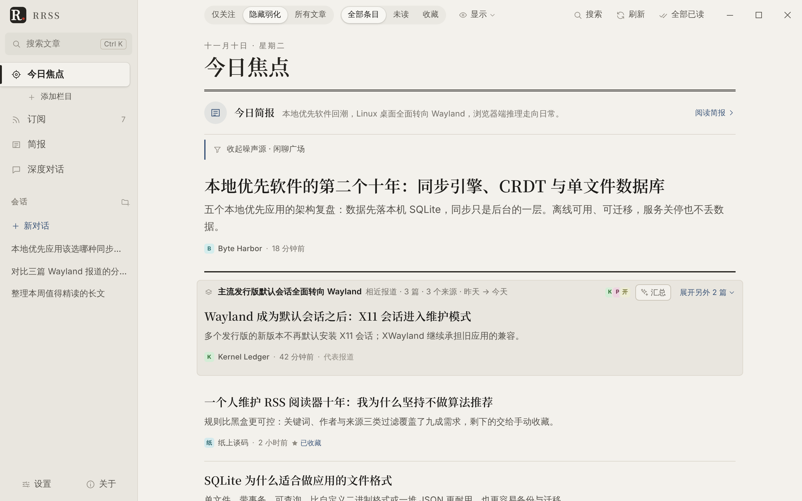
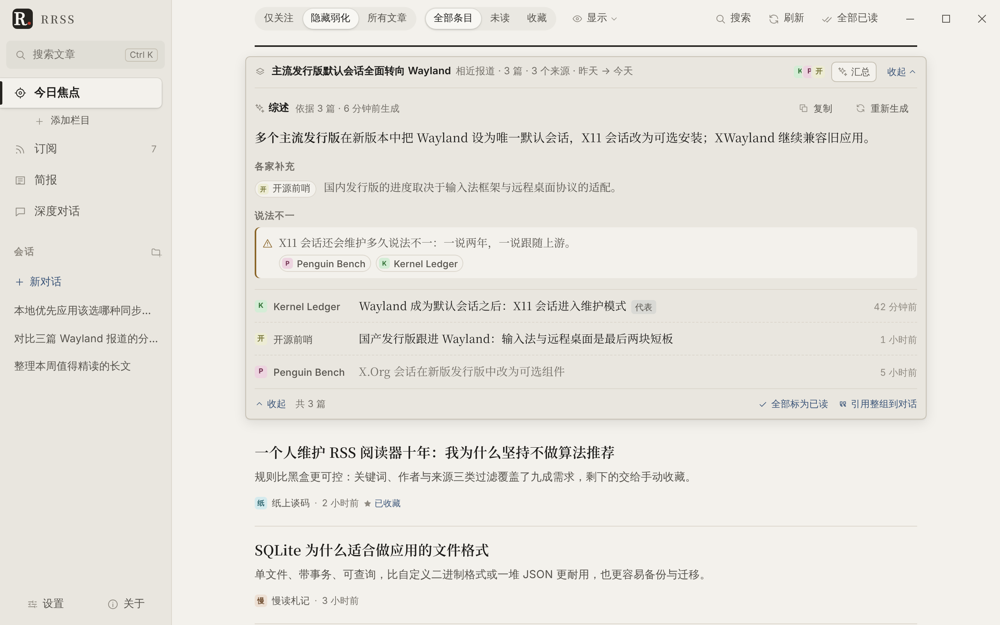
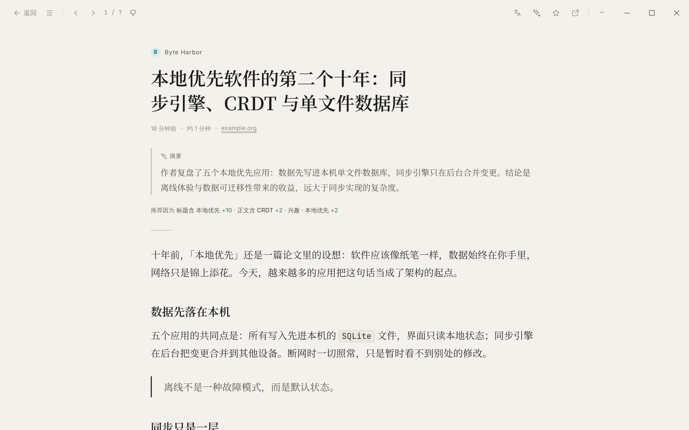
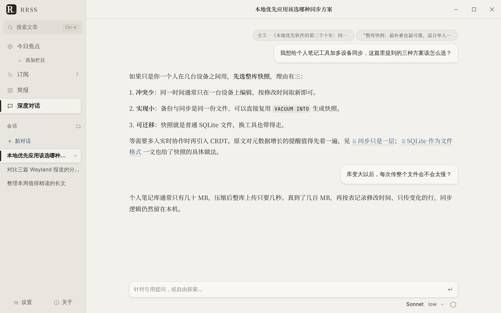
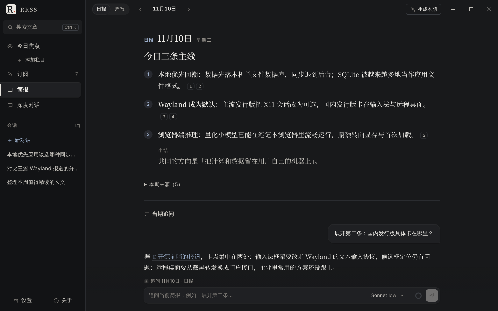
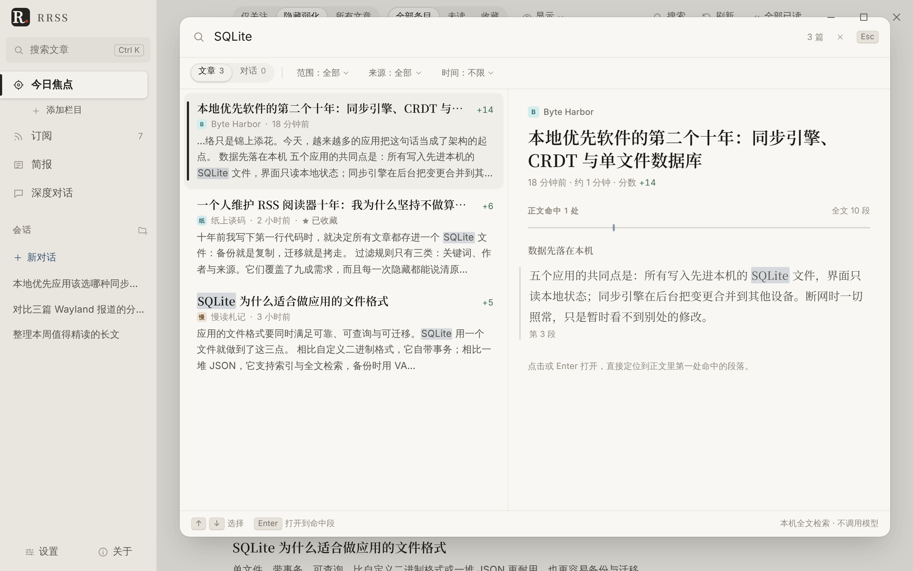
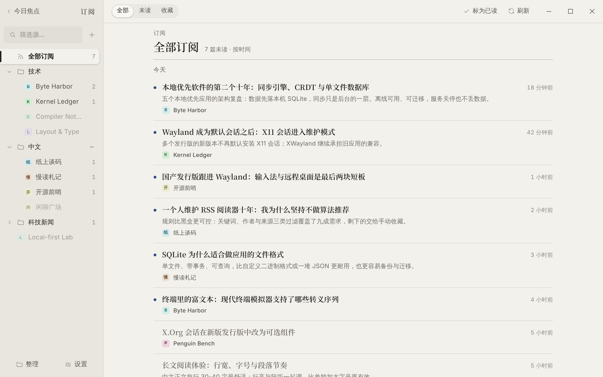
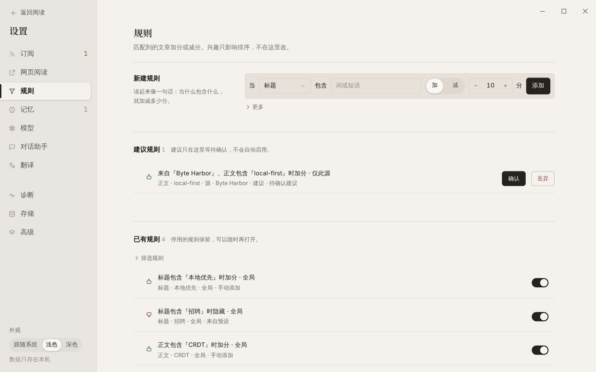
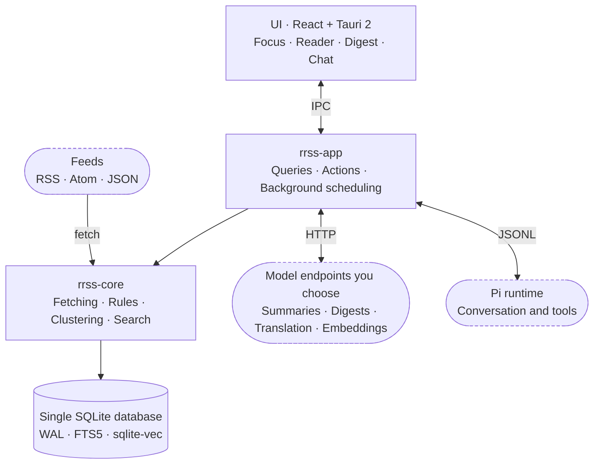

<div align="center">


# RRSS

**A local-first, AI-assisted reading hub**

Rules filter for you; AI helps you get through it, understand it and keep asking.<br>
Articles, the full-text index, vectors and conversations all stay on your own computer.

[](#getting-started)
[](LICENSE)
[](https://tauri.app)
[](https://www.rust-lang.org)
[](https://react.dev)
[](https://sqlite.org)

[Features](#features) · [Getting started](#getting-started) · [Architecture](#architecture) · [Development](#development) · [Docs](#docs)

[简体中文](README.md) · **English**

</div>

<br>

> [!NOTE]
> The app's interface, the AI prompts and the developer docs are currently in Simplified Chinese. Feeds and articles in any language work as usual, and the built-in translation can render articles side by side in your language. An English interface is not available yet.

<picture>
  <source media="(prefers-color-scheme: dark)" srcset="doc/images/focus-dark.webp">
  
</picture>

## Why RRSS

<table>
  <tr>
    <td width="33%" valign="top">
      <h3>🎯 Rules filter first</h3>
      Keywords, authors, sources, URL patterns… every boost and every hide says why. Interest similarity only affects ordering; it never silently hides anything.
    </td>
    <td width="33%" valign="top">
      <h3>🔌 Bring your own AI</h3>
      Summaries, digests and translation work with any OpenAI-compatible endpoint: OpenAI, DeepSeek, OpenRouter or a local Ollama. Pick a model per task and set a daily budget.
    </td>
    <td width="33%" valign="top">
      <h3>🔒 Your data stays local</h3>
      Articles, the full-text index, vectors and conversations live in a single SQLite file. No extra database or cloud service; a backup is one file.
    </td>
  </tr>
</table>

## Features

### Today's Focus: what's worth reading first

You open the app to a ranked card stream, not a mountain of unread counts.

- **Explainable ranking**: rule scores plus a light interest bias. Switch between "Following only", "Dim the rest" and "All articles" in one click; noisy sources fold away on their own.
- **Related coverage, grouped**: reports of the same event from several sources merge into one group. One click writes an overview of what they agree on, what each adds and where they disagree, with every point attributed.
- **Focus columns**: turn a folder into a column to read by topic.



### Reading and conversation

<table>
  <tr>
    <td width="50%"></td>
    <td width="50%"></td>
  </tr>
  <tr>
    <td valign="top"><b>Reader</b>: articles are cleaned up and typeset, with an AI summary and "Recommended because…" at the top. Full side-by-side translation and translate-on-selection (LLM / DeepL / DeepLX). The original page opens in an isolated webview inside the reading area.</td>
    <td valign="top"><b>Conversation</b>: bring a whole article or a selected passage into a chat. A tool loop driven by the Pi runtime can search your local articles and call external tools you configure (MCP); links in answers go straight back to the source.</td>
  </tr>
</table>

### Digests and search

<table>
  <tr>
    <td width="50%"></td>
    <td width="50%"></td>
  </tr>
  <tr>
    <td valign="top"><b>Digests</b>: daily and weekly digests are generated for you. Every point carries source numbers that open the original; ask follow-up questions right below.</td>
    <td valign="top"><b>Search</b>: <kbd>Ctrl</kbd> + <kbd>K</kbd> searches articles and conversations, previews the matching passage, and Enter jumps right to it. Local full-text index, no model calls.</td>
  </tr>
</table>

### Feeds and rules

<table>
  <tr>
    <td width="50%"></td>
    <td width="50%"></td>
  </tr>
  <tr>
    <td valign="top"><b>Feeds</b>: folder tree with drag-and-drop, OPML import and export. Sources that have gone quiet, keep failing or are mostly noise get flagged.</td>
    <td valign="top"><b>Rules</b>: rules that read like a sentence. Suggestions from the system wait here for your confirmation and never take effect on their own.</td>
  </tr>
</table>

### And also

- **Memory and interests**: preferences distilled from conversations land in "Pending" first and only affect ranking once you agree.
- **Network proxy**: global or per-purpose HTTP / SOCKS5 proxies; on Windows the system proxy can be read directly.
- **Built for the long run**: backup and restore, article retention, a storage overview, logs and a diagnostics bundle.
- **Light and dark themes**, a custom title bar, and <kbd>J</kbd> / <kbd>K</kbd> to move between articles.

## Getting started

### Download

Get the package for your platform from [Releases](https://github.com/rrss-app/rrss/releases):

| Platform | Package | Requirements |
| :-- | :-- | :-- |
| Linux x64 | `rrss-linux-x64.tar.gz` | WebKitGTK 4.1 (`libwebkit2gtk-4.1-0` on Debian / Ubuntu) |
| Windows x64 | `rrss-windows-x64.zip` / `rrss-windows-x64-msvc.zip` | WebView2 Runtime (included in Windows 11) |

Unpack and run `rrss` (`rrss.exe` on Windows).

### Three steps

1. **Add feeds**: paste a URL, or import OPML under Settings → Feeds (设置 → 订阅).
2. **Connect a model** (optional): under Settings → Models (设置 → 模型), add OpenAI / DeepSeek / OpenRouter / Ollama or any OpenAI-compatible endpoint, then pick a model for summaries, digests, translation and conversation. Rules, reading and search work without a model.
3. **Write a few rules**: boost or hide under Settings → Rules (设置 → 规则), and the focus stream re-ranks right away.

## Product boundaries

- The app opens to the Today's Focus card stream. Digests are the daily / weekly view, conversation has its own entry point, and there is no classic three-pane RSS layout.
- Rules filter first and every reason is explained. Explicit training follows the spirit of the [NewsBlur Intelligence Trainer](https://www.newsblur.com/features/intelligence-training); a black-box model is never the main filter. Interest similarity only affects what is shown.
- Summaries and digests use HTTP completions; Pi starts only when you ask a follow-up. Citations use structured article IDs rather than pasting full text into the chat.
- The system WebView draws only the app shell. Article text goes through a sanitized block IR, and original pages open only in an isolated child webview (see [Security boundaries](doc/architecture.md#安全边界), in Chinese); video cards open externally. Formula / Mermaid rendering, WYSIWYG editing and an outward-facing MCP server are out of scope for now.
- By default the app only goes online for your subscriptions (including article images and site icons), the AI endpoints you choose, and the Pi runtime download for conversation (downloaded on first start if missing; can be turned off in settings). No usage statistics are sent. All data lives in one SQLite database. macOS is planned but not part of the first release.

## Architecture



| Module | Responsibility |
| :-- | :-- |
| `apps/desktop` | React + Vite UI: draws the interface, calls IPC, handles interaction |
| `crates/rrss-desktop` | Tauri 2 window, command adapters and the `rrss://` local media protocol |
| `crates/rrss-app` | Orchestration: queries, actions, background scheduling, translation and the Pi runtime |
| `crates/rrss-core` | SQLite, domain model, fetching, rules, ranking, clustering, networking and platform adapters |
| `crates/rrss-render` | Sanitizes HTML / Markdown into a block IR |
| `crates/rrss-ai` | HTTP completions, embeddings and the Pi protocol |

See the [architecture overview](doc/architecture.md) (in Chinese) for the full picture.

## Development

You need Node 22, pnpm 10 and stable Rust; on Linux also `libwebkit2gtk-4.1-dev`. On Linux / WSL, day-to-day work uses a Debug build with Vite hot reload. From the repository root:

```sh
pnpm --dir apps/desktop install
pnpm --dir apps/desktop dev:desktop
```

Environment, code layout, conventions and tests are in [CONTRIBUTING](CONTRIBUTING.md) (in Chinese). The screenshots above are generated with demo data by [`e2e/readme-shots.spec.ts`](apps/desktop/e2e/readme-shots.spec.ts) and can be regenerated after UI changes.

## Docs

The documents below are in Chinese.

- [Architecture overview](doc/architecture.md): layers, data flow, storage, and the security, network and privacy boundaries.
- [Contributing](CONTRIBUTING.md): environment, running, code layout, conventions and tests.
- [Security](SECURITY.md): how to report a vulnerability privately.
- [Changelog](CHANGELOG.md): user-facing changes in each release.
- Test data: [feeds](testdata/feeds/README.md) · [rendering](testdata/render/README.md) · [Pi mocks](testdata/pi/README.md).

## License

The app is [MIT](LICENSE). Tauri is MIT / Apache-2.0; the About page keeps the app's MIT notice.
