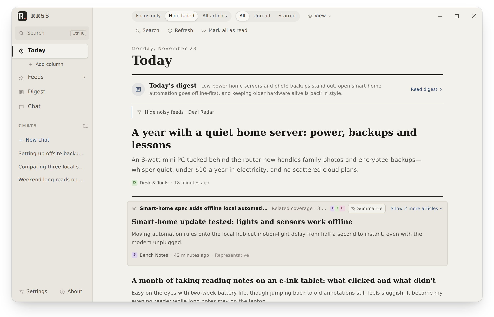
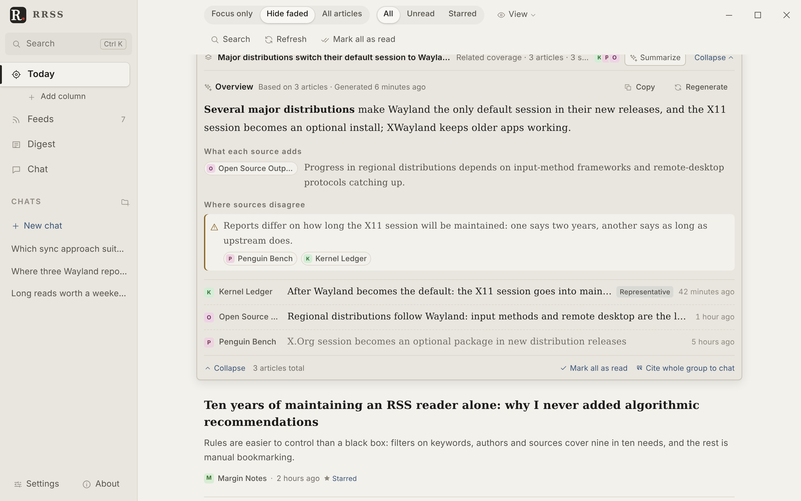
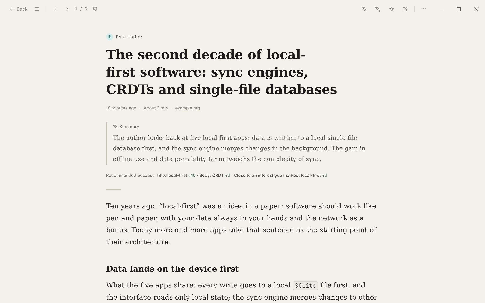
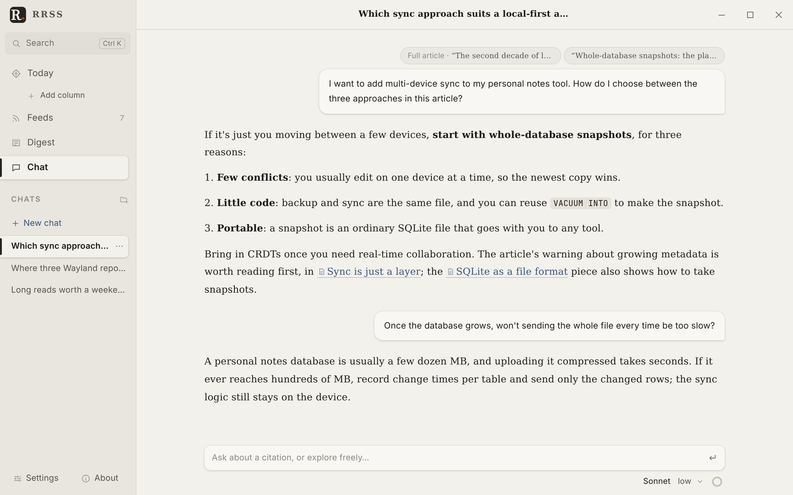
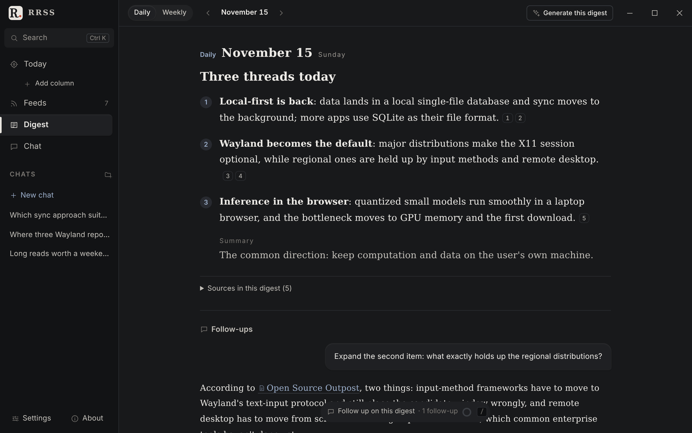
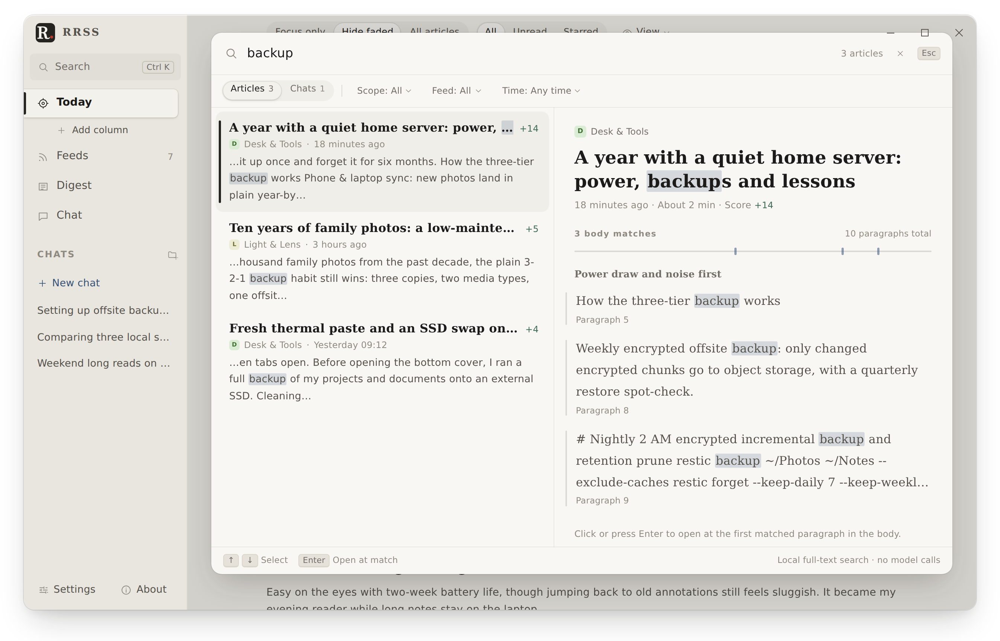
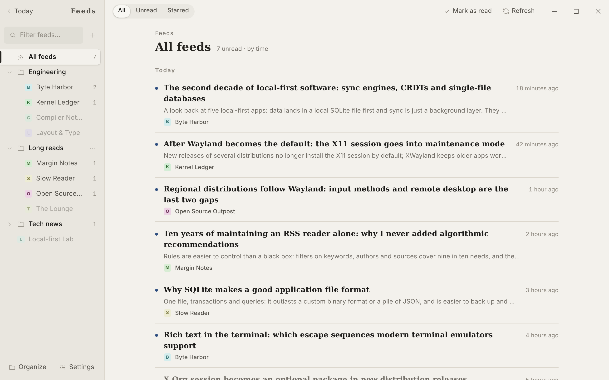
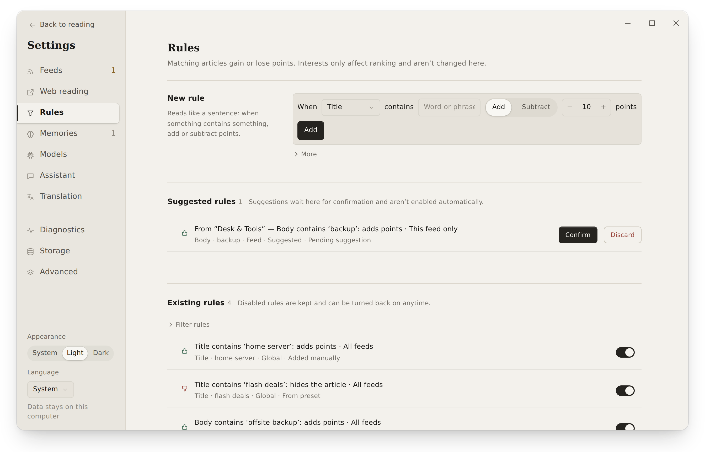
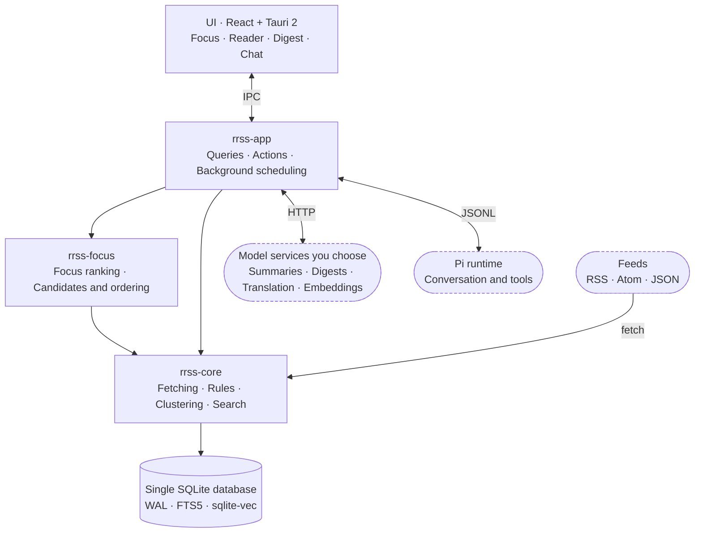

<div align="center">


# RRSS

**A local-first, AI-assisted reading hub**

Rules filter for you; AI helps you read, understand, and dig deeper.<br>
Your subscriptions, articles, and conversations all stay on your own computer.

[](#getting-started)
[](LICENSE)
[](https://tauri.app)
[](https://www.rust-lang.org)
[](https://react.dev)
[](https://sqlite.org)

[Features](#features) · [Getting started](#getting-started) · [Architecture](#architecture) · [Development](#development) · [Docs](#docs)

[简体中文](README.md) · **English**

</div>

<br>

> [!NOTE]
> The interface is available in English and Simplified Chinese (follows your system language by default; switch anytime under Settings → Language). AI summaries, digests, and overviews follow the interface language or a language you choose, and the chat assistant replies in the language you write in. Feeds in any language work as usual, with built-in side-by-side translation. Developer docs are currently in Chinese.

<picture>
  <source media="(prefers-color-scheme: dark)" srcset="doc/images/en/focus-dark.webp">
  
</picture>

## Why RRSS

<table>
  <tr>
    <td width="33%" valign="top">
      <h3>🎯 Rules filter first</h3>
      Write rules by keyword, author, source, or URL—every boost and hide explains why. Your reading habits only adjust the order and never silently hide an article.
    </td>
    <td width="33%" valign="top">
      <h3>🔌 Bring your own AI</h3>
      Connect OpenAI, DeepSeek, OpenRouter, local Ollama, or any OpenAI-compatible service for summaries, digests, translation, and chat. Pick a model per task and set a daily budget.
    </td>
    <td width="33%" valign="top">
      <h3>🔒 Everything stays local</h3>
      Articles, search indexes, and conversations live in a single SQLite file on your machine—no cloud account or external database needed. A backup is just one file.
    </td>
  </tr>
</table>

## Features

### Today's Focus: read what matters first

Open the app to a ranked card stream instead of an overwhelming pile of unread counts.

- **Transparent, controllable ranking**: rule scores come first, refined by your reading habits, with every card able to show why it was picked. Switch between "Focus only", "Hide faded", and "All articles" in one click; noisy feeds fold away automatically, and likes or dislikes can be undone or turned into rules whenever you want.
- **Related coverage, grouped**: multiple reports on the same story merge into one group, with a one-click overview highlighting consensus, unique additions, and disagreements—each linked to its source.
- **Topic columns**: pin any folder as a Focus column to browse by topic.



### Reading and conversation

<table>
  <tr>
    <td width="50%"></td>
    <td width="50%"></td>
  </tr>
  <tr>
    <td valign="top"><b>Reader</b>: cleans up and typesets articles with syntax-highlighted code blocks and local playback for direct audio and video. Includes an AI summary and recommendation reasons at the top, full side-by-side or selection translation (LLM / DeepL / DeepLX), and an in-app view of the original page.</td>
    <td valign="top"><b>Conversation</b>: ask questions about an entire article or a highlighted passage. The assistant can search your local library and long-term memories, call external tools you configure (MCP), and link answers straight back to the source.</td>
  </tr>
</table>

### Digests and search

<table>
  <tr>
    <td width="50%"></td>
    <td width="50%"></td>
  </tr>
  <tr>
    <td valign="top"><b>Digests</b>: automatic daily and weekly digests where every point carries numbered source links that open the original article. Ask follow-up questions right below the digest.</td>
    <td valign="top"><b>Search</b>: press <kbd>Ctrl</kbd> + <kbd>K</kbd> to search articles and past conversations, preview matching passages side by side, and hit Enter to jump straight to that spot. Powered by a local full-text index—no model calls required.</td>
  </tr>
</table>

### Feeds and rules

<table>
  <tr>
    <td width="50%"></td>
    <td width="50%"></td>
  </tr>
  <tr>
    <td valign="top"><b>Feeds</b>: drag-and-drop folder tree, OPML import and export, and custom refresh intervals per feed. Stale, failing, rate-limited, or overly noisy sources are flagged automatically.</td>
    <td valign="top"><b>Rules</b>: create boost or hide rules that read like plain sentences. Rule suggestions generated from your feedback wait here for your approval and never take effect on their own.</td>
  </tr>
</table>

### And more

- **Memories and interests**: long-term preferences noticed in chat go to "Pending" first and only take effect once you confirm them.
- **Network proxy**: set global or per-purpose HTTP / SOCKS5 proxies; on Windows, RRSS can read your system proxy directly.
- **Built for the long run**: single-file backup and restore, automatic retention cleanup for old article bodies, a storage overview, and sanitized diagnostic bundles.
- **Desktop polish**: light and dark themes, background refresh in the system tray, <kbd>J</kbd> / <kbd>K</kbd> keyboard navigation, and related reading at the end of articles.

## Getting started

### Download

Grab the archive for your platform from [Releases](https://github.com/rrss-app/rrss/releases):

| Platform | Package | Requirements |
| :-- | :-- | :-- |
| Linux x64 | `rrss-linux-x64.tar.gz` | WebKitGTK 4.1 (`libwebkit2gtk-4.1-0` on Debian / Ubuntu). For H.264 video playback in the reader, also install GStreamer codecs (`gstreamer1.0-plugins-good`, `gstreamer1.0-plugins-bad`, and `gstreamer1.0-libav` on Debian / Ubuntu) |
| Windows x64 | `rrss-windows-x64.zip` / `rrss-windows-x64-msvc.zip` | WebView2 Runtime (pre-installed on Windows 11) |

Extract the archive and run `rrss` (`rrss.exe` on Windows).

### Three steps to start

1. **Add feeds**: paste an RSS, Atom, or JSON Feed URL under Settings → Feeds, or import an OPML file.
2. **Connect a model** (optional): add OpenAI, DeepSeek, OpenRouter, local Ollama, or any OpenAI-compatible service under Settings → Models, then choose models for summaries, digests, translation, and chat. Subscriptions, rules, reading, and local search all work without AI.
3. **Add a few rules**: boost or hide topics under Settings → Rules, and Today's Focus re-ranks immediately.

## Design principles and privacy

- **Focused reading, not a three-pane inbox**: the app opens to Today's Focus, with dedicated views for digests and conversation. Whenever you prefer chronological browsing by source, switch to the Feeds view.
- **Rules decide what's hidden; habits only reorder**: hiding is strictly controlled by your rules, inspired by the [NewsBlur Intelligence Trainer](https://www.newsblur.com/features/intelligence-training). Learned reading habits and the optional experimental ranking model only adjust the order of visible articles—never a black-box filter.
- **Safe typesetting and isolated web browsing**: article content is sanitized before rendering, the main UI never runs remote scripts, and images plus direct audio/video load from local cache. Viewing an original page opens an isolated in-app web view (see [Security boundaries](doc/architecture.md#安全边界), in Chinese), while YouTube and Bilibili links open externally from cover cards. Math / Mermaid rendering and WYSIWYG editing are out of scope for now.
- **Clear network and privacy boundaries**: zero telemetry or usage tracking. By default, RRSS only goes online to fetch your subscriptions and media, call the AI services you configure, and download the Pi chat engine on first use if needed (can be disabled in Settings). Everything is stored in a single local SQLite database. Currently supports Windows and Linux; macOS is not yet supported.

## Architecture



| Module | Responsibility |
| :-- | :-- |
| `apps/desktop` | React + Vite desktop UI: presentation, interaction, and IPC calls |
| `crates/rrss-desktop` | Tauri 2 window, command adapters, and the `rrss://` local media protocol |
| `crates/rrss-app` | Application orchestration: queries, actions, background scheduling, translation, and Pi runtime management |
| `crates/rrss-focus` | Focus recommendations: ranking, candidate pool, ordering, exploration, and spot checks |
| `crates/rrss-core` | SQLite storage, domain model, fetching, rules, clustering, networking, and platform adapters |
| `crates/rrss-render` | Sanitizes HTML / Markdown into a structured block IR |
| `crates/rrss-ai` | HTTP completions, embeddings, and the Pi protocol |

See the [architecture overview](doc/architecture.md) (in Chinese) for layers, data flow, and security boundaries.

## Development

Development requires Node 22, pnpm 10, and stable Rust (plus `libwebkit2gtk-4.1-dev` on Linux). Run a Debug build with Vite hot reload from the repository root:

```sh
pnpm --dir apps/desktop install
pnpm --dir apps/desktop dev:desktop
```

Setup, code layout, conventions, and testing are documented in [CONTRIBUTING](CONTRIBUTING.md) (in Chinese). The screenshots above are generated from fictional demo data by [`e2e/readme-shots.spec.ts`](apps/desktop/e2e/readme-shots.spec.ts).

## Docs

The documents below are in Chinese.

- [Architecture overview](doc/architecture.md): layers, data flow, storage, and security/privacy boundaries.
- [Contributing](CONTRIBUTING.md): environment, running, code layout, conventions, and tests.
- [Security](SECURITY.md): how to report a vulnerability privately.
- [Changelog](CHANGELOG.md): user-facing changes in each release.
- Test data: [feeds](testdata/feeds/README.md) · [rendering](testdata/render/README.md) · [Pi mocks](testdata/pi/README.md).

## License

The app is licensed under [MIT](LICENSE). Tauri is MIT / Apache-2.0; the About page preserves the app's MIT notice.
