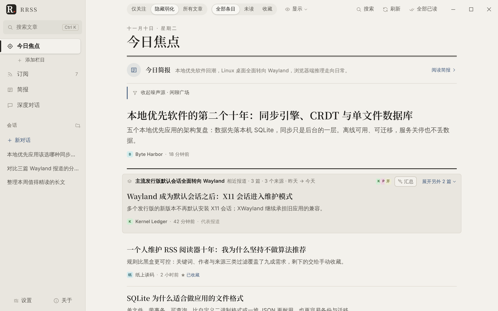
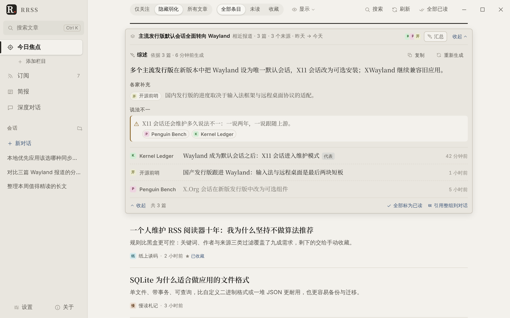
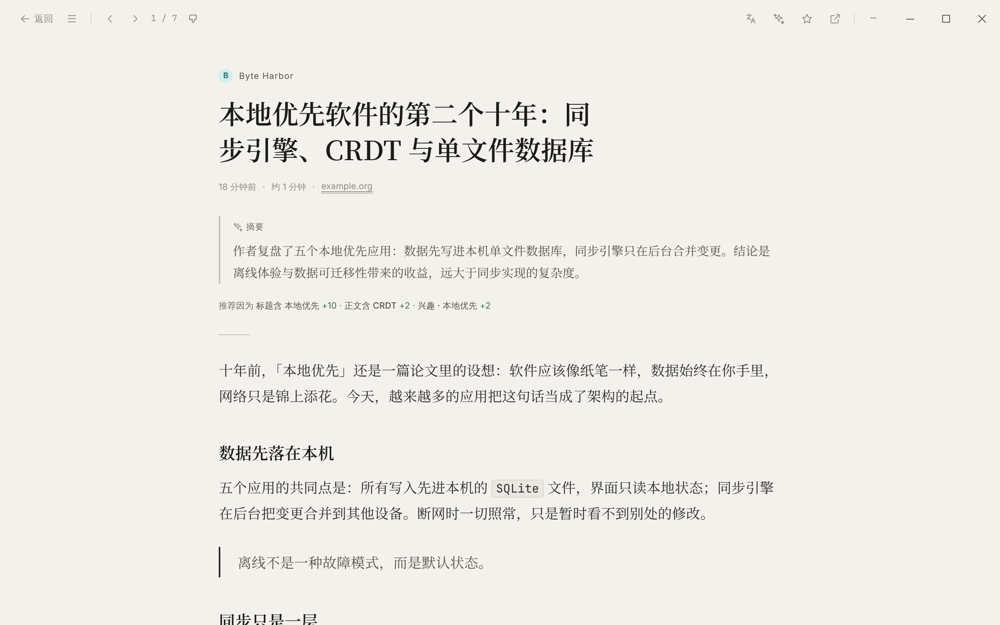
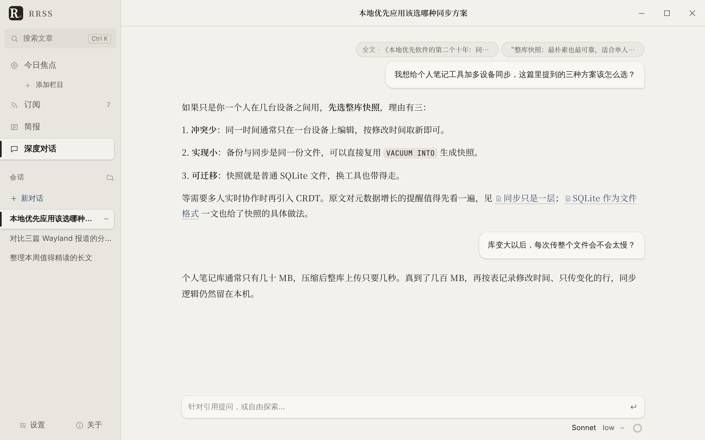
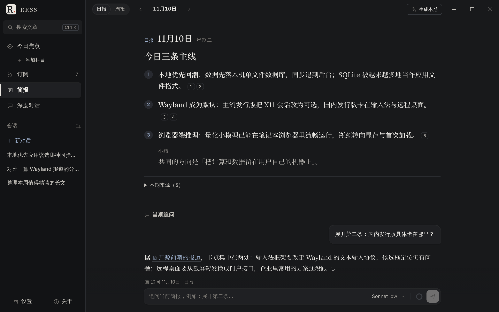
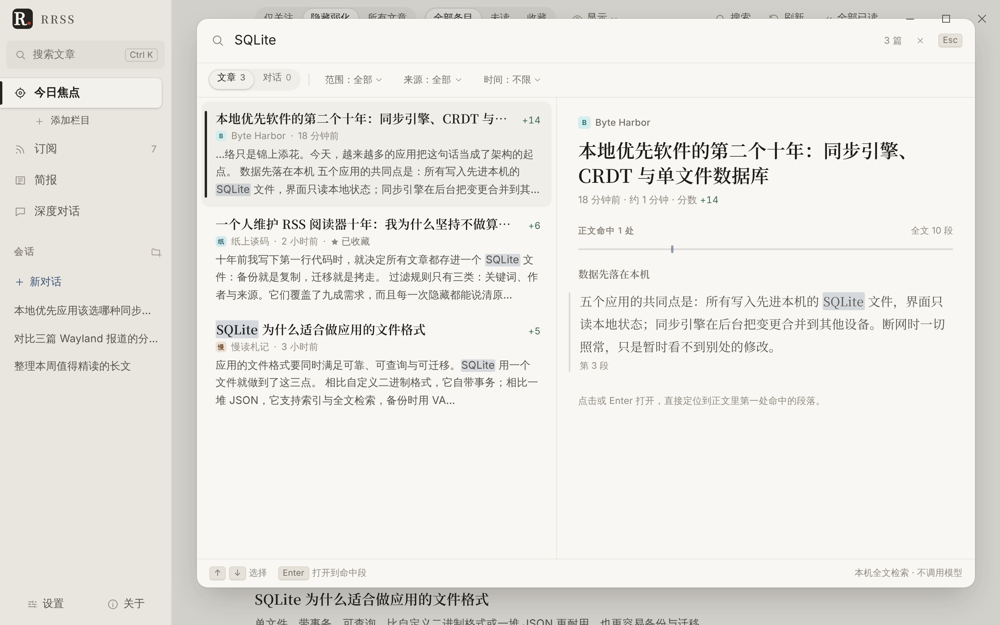
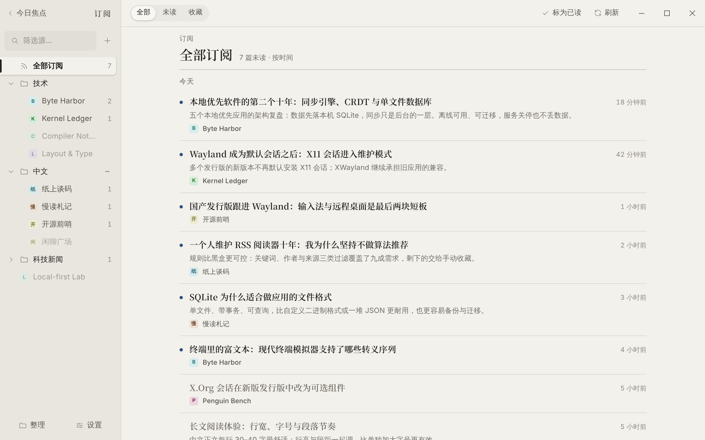
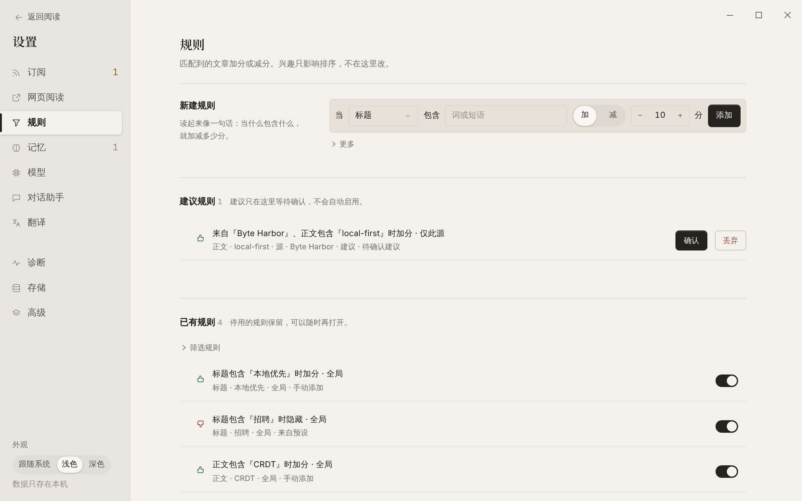
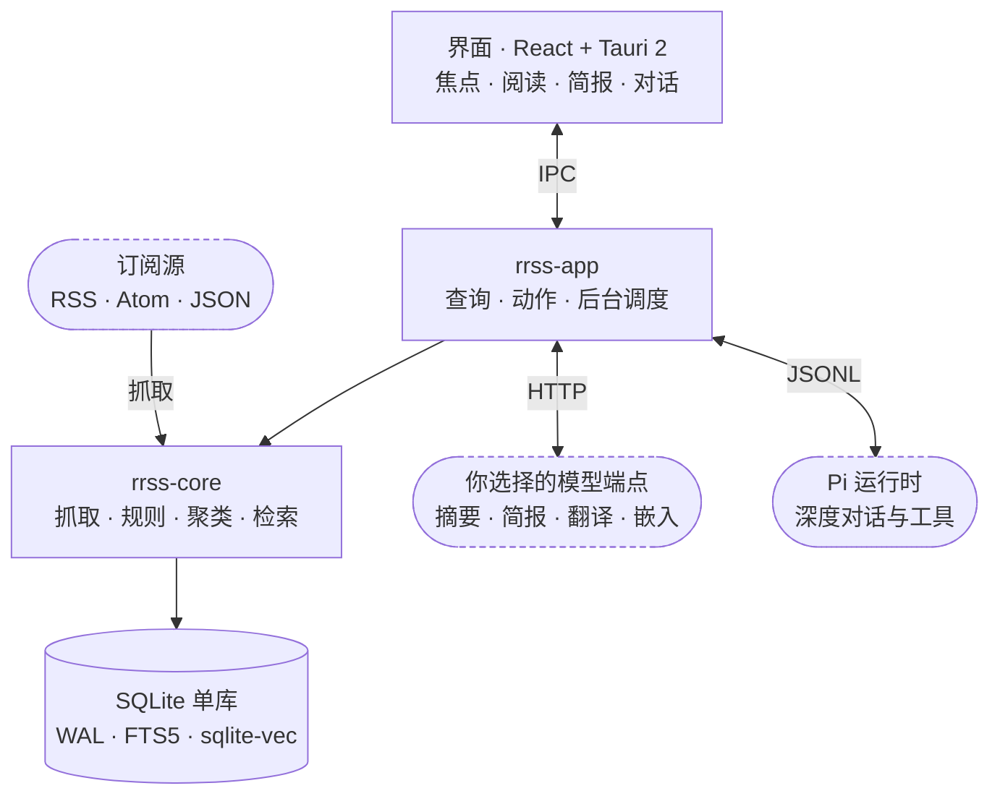

<div align="center">


# RRSS

**本地优先的智能信息中枢**

规则替你筛选，AI 帮你读完、读懂、追问到底。<br>
文章、全文索引、向量与对话都留在你自己的电脑上。

[](#快速开始)
[](LICENSE)
[](https://tauri.app)
[](https://www.rust-lang.org)
[](https://react.dev)
[](https://sqlite.org)

[功能](#功能) · [快速开始](#快速开始) · [架构](#架构) · [开发](#开发) · [文档](#文档)

</div>

<br>

<picture>
  <source media="(prefers-color-scheme: dark)" srcset="doc/images/focus-dark.webp">
  
</picture>

## 为什么是 RRSS

<table>
  <tr>
    <td width="33%" valign="top">
      <h3>🎯 规则先过滤</h3>
      关键词、作者、来源、URL 正则……每一次加分和隐藏都写明原因。兴趣相似度只影响排序，不会静默藏起任何内容。
    </td>
    <td width="33%" valign="top">
      <h3>🔌 AI 可替换</h3>
      摘要、简报、翻译接任意 OpenAI 兼容端点：OpenAI、DeepSeek、OpenRouter 或本机 Ollama。按用途分配模型，设每日预算。
    </td>
    <td width="33%" valign="top">
      <h3>🔒 数据在本机</h3>
      文章、全文索引、向量与对话都在一个 SQLite 文件里，不需要额外的数据库或云服务。备份就是一个文件。
    </td>
  </tr>
</table>

## 功能

### 今日焦点：先看最值得看的

打开就是排好序的卡片流，而不是堆成山的未读数。

- **可解释的排序**：规则打分加兴趣弱偏向，「仅关注 / 隐藏弱化 / 所有文章」一键切换；噪声源自动收起。
- **相近报道成组**：同一事件的多家报道合成一组，一键生成综述——共识、各家补充、说法分歧，每条都标出来源。
- **焦点栏目**：把文件夹设为栏目，按主题分开看。



### 阅读与对话

<table>
  <tr>
    <td width="50%"></td>
    <td width="50%"></td>
  </tr>
  <tr>
    <td valign="top"><b>阅读器</b>：正文清洗后排版，顶部是 AI 摘要和「推荐因为……」；整篇对照翻译与划词翻译（大模型 / DeepL / DeepLX）；原网页嵌在阅读区的隔离 webview 里打开。</td>
    <td valign="top"><b>深度对话</b>：把整篇文章或划选的一段带进对话。由 Pi 运行时驱动工具循环，能检索本机文章、调用你配置的外部工具（MCP），回答里的链接直接回到原文。</td>
  </tr>
</table>

### 简报与搜索

<table>
  <tr>
    <td width="50%"></td>
    <td width="50%"></td>
  </tr>
  <tr>
    <td valign="top"><b>简报</b>：自动生成日报 / 周报，每条结论后都有来源编号，点开就是原文；读完直接在下方追问。</td>
    <td valign="top"><b>搜索</b>：<kbd>Ctrl</kbd> + <kbd>K</kbd> 检索文章与对话，预览命中的段落，回车直接跳到那一段。本机全文索引，不调用模型。</td>
  </tr>
</table>

### 订阅与规则

<table>
  <tr>
    <td width="50%"></td>
    <td width="50%"></td>
  </tr>
  <tr>
    <td valign="top"><b>订阅</b>：文件夹树与拖动整理，OPML 导入导出；长期不更新、连续失败或噪声过多的源会被标出来。</td>
    <td valign="top"><b>规则</b>：读起来像一句话的规则；系统给的建议只在这里等你确认，不会自己生效。</td>
  </tr>
</table>

### 还有这些

- **记忆与兴趣**：对话里提炼出的偏好先进「待确认」，你同意后才影响排序。
- **网络代理**：全局或按用途设置 HTTP / SOCKS5 代理；Windows 可直接读取系统代理。
- **长期使用**：备份与恢复、文章保留策略、存储占用一览、运行日志与诊断包。
- **深浅色主题**、自绘标题栏，键盘 <kbd>J</kbd> / <kbd>K</kbd> 翻篇。

## 快速开始

### 下载安装

从 [Releases](https://github.com/rrss-app/rrss/releases) 下载对应平台的包：

| 平台 | 安装包 | 运行要求 |
| :-- | :-- | :-- |
| Linux x64 | `rrss-linux-x64.tar.gz` | WebKitGTK 4.1（Debian / Ubuntu 为 `libwebkit2gtk-4.1-0`） |
| Windows x64 | `rrss-windows-x64.zip` / `rrss-windows-x64-msvc.zip` | WebView2 Runtime（Windows 11 自带） |

解压后运行 `rrss`（Windows 为 `rrss.exe`）。

### 三步上手

1. **添加订阅**：粘贴网址，或在「设置 → 订阅」导入 OPML。
2. **接上模型**（可选）：在「设置 → 模型」添加 OpenAI / DeepSeek / OpenRouter / Ollama 或任意 OpenAI 兼容端点，再给摘要、简报、翻译、对话分别选模型。不接模型也能用规则、阅读与搜索。
3. **写几条规则**：在「设置 → 规则」加分或隐藏，焦点流会马上按新规则重排。

## 产品边界

- 默认进入「今日焦点」卡片流；简报是日报 / 周报主视图，深度对话是独立入口，不做经典三栏 RSS。
- 规则先过滤、原因可解释；参考 [NewsBlur Intelligence Trainer](https://www.newsblur.com/features/intelligence-training) 的显式训练，不把黑盒模型当主过滤器。兴趣相似度只影响可见列表。
- 摘要 / 简报生成走 HTTP 补全；用户追问才启动 Pi。引用使用结构化文章 ID，而非把全文贴进聊天。
- 系统 WebView 只画本应用外壳；正文走清洗后的块 IR，原网页只在隔离的子 webview 里打开（见[安全边界](doc/architecture.md#安全边界)），视频卡片外开。首期不做公式 / Mermaid 渲染、所见即所得编辑或对外 MCP。
- 默认网络活动限于订阅内容（含文章图片与站点图标）、你选择的 AI 端点，以及对话用的 Pi 运行时下载（未安装时启动即自动下载，可在设置里关闭）；不发送使用统计。数据使用单库 SQLite。macOS 仅预留，不列入首发。

## 架构



| 模块 | 职责 |
| :-- | :-- |
| `apps/desktop` | React + Vite 界面，只画界面、调 IPC、管交互 |
| `crates/rrss-desktop` | Tauri 2 窗口、命令适配与 `rrss://` 本地媒体协议 |
| `crates/rrss-app` | 业务编排：查询、动作、后台调度、翻译与 Pi 运行时 |
| `crates/rrss-core` | SQLite、领域模型、抓取、规则、排序、聚类、网络与平台适配 |
| `crates/rrss-render` | HTML / Markdown 清洗并转成块 IR |
| `crates/rrss-ai` | HTTP 补全、嵌入与 Pi 协议 |

完整说明见[架构概览](doc/architecture.md)。

## 开发

需要 Node 22、pnpm 10、Rust stable；Linux 另需 `libwebkit2gtk-4.1-dev`。Linux / WSL 日常使用 Debug + Vite 热更新，在仓库根目录运行：

```sh
pnpm --dir apps/desktop install
pnpm --dir apps/desktop dev:desktop
```

环境、目录分工、开发约定与测试见 [参与开发](CONTRIBUTING.md)。上面的截图由 [`e2e/readme-shots.spec.ts`](apps/desktop/e2e/readme-shots.spec.ts) 用演示数据生成，界面变化后可重新生成。

## 文档

- [架构概览](doc/architecture.md)：分层、数据流、存储，以及安全、网络与隐私边界。
- [参与开发](CONTRIBUTING.md)：环境、运行、目录分工、开发约定与测试。
- [安全](SECURITY.md)：如何私下报告漏洞。
- 测试数据：[馈源](testdata/feeds/README.md) · [渲染](testdata/render/README.md) · [Pi 模拟](testdata/pi/README.md)。

## 许可

应用主体为 [MIT](LICENSE)。Tauri 为 MIT / Apache-2.0；关于页保留应用 MIT 声明。
