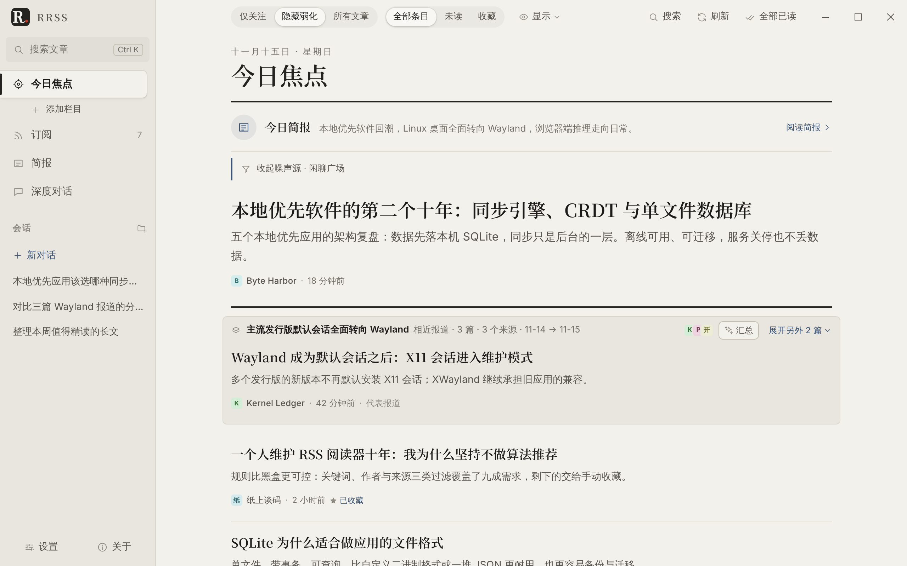
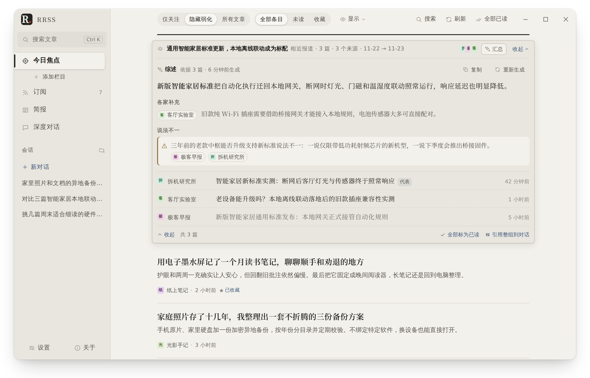
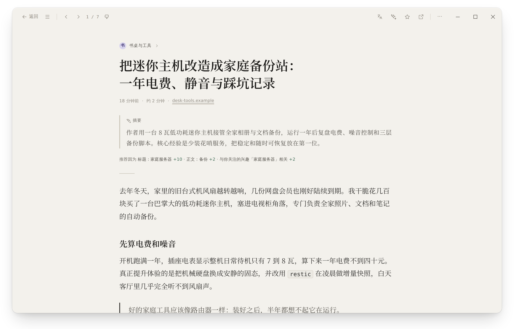
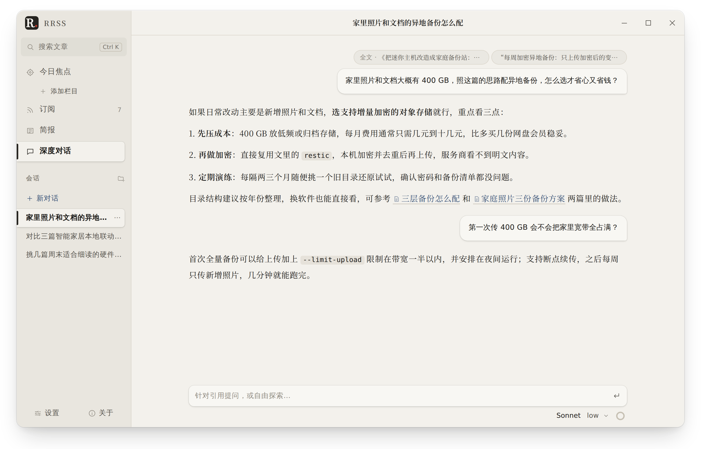
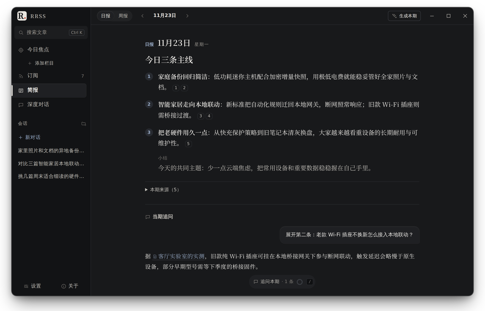
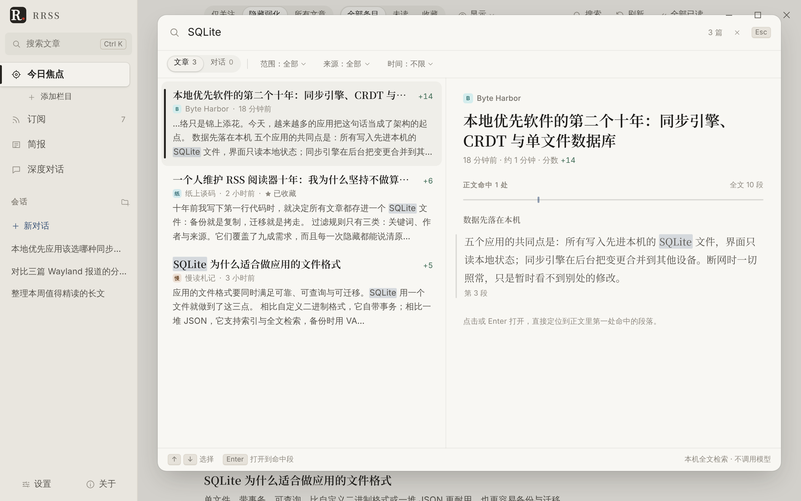
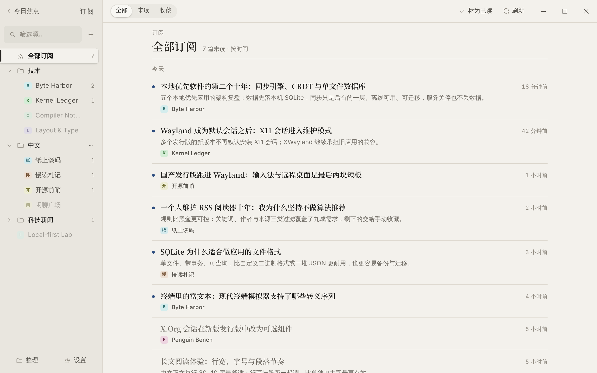
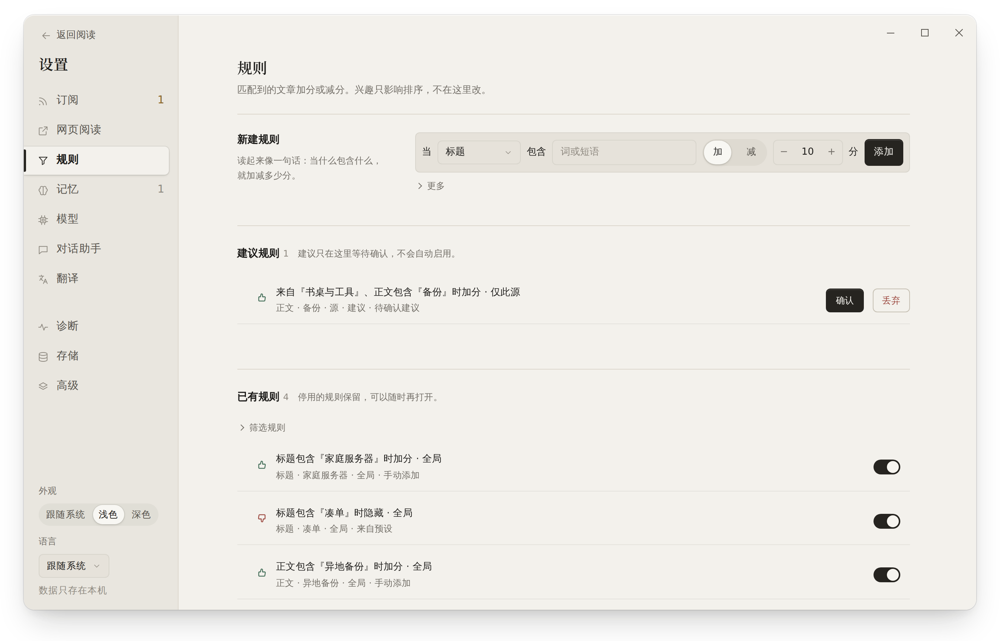
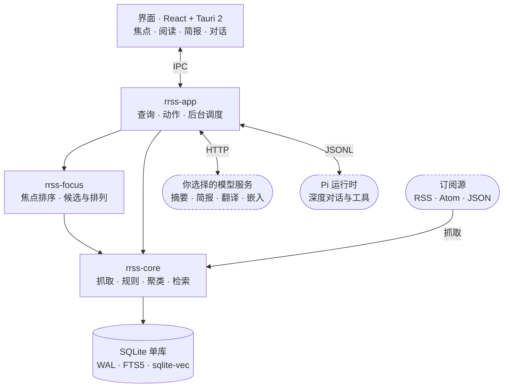

<div align="center">


# RRSS

**本地优先的智能信息中枢**

规则替你筛选，AI 帮你读完、读懂、追问到底。<br>
订阅、文章与对话全部保存在你自己的电脑上。

[](#快速开始)
[](LICENSE)
[](https://tauri.app)
[](https://www.rust-lang.org)
[](https://react.dev)
[](https://sqlite.org)

[功能](#功能) · [快速开始](#快速开始) · [架构](#架构) · [开发](#开发) · [文档](#文档)

**简体中文** · [English](README.en.md)

</div>

<br>

> [!NOTE]
> 界面支持简体中文与英文（默认跟随系统，可在「设置 → 语言」随时切换）。摘要、简报与综述默认跟随界面语言，也可单独指定；对话助手会按你的提问语言回答。

<picture>
  <source media="(prefers-color-scheme: dark)" srcset="doc/images/focus-dark.webp">
  
</picture>

## 为什么是 RRSS

<table>
  <tr>
    <td width="33%" valign="top">
      <h3>🎯 规则先过滤</h3>
      按关键词、作者、来源或网址编写规则，每一次加分和隐藏都写明原因。你的阅读偏好只调整排序，绝不会悄悄藏起文章。
    </td>
    <td width="33%" valign="top">
      <h3>🔌 AI 自由选配</h3>
      摘要、简报、翻译与对话可接 OpenAI、DeepSeek、OpenRouter、本机 Ollama 或任意 OpenAI 兼容服务；按任务分别选模型，并设每日用量上限。
    </td>
    <td width="33%" valign="top">
      <h3>🔒 数据留在本机</h3>
      文章、搜索索引与对话全部存在本机单个 SQLite 文件里，无需云账号或额外服务。备份与迁移就是一个文件。
    </td>
  </tr>
</table>

## 功能

### 今日焦点：先看最值得看的

打开即见排好序的卡片流，而不是压迫感满满的未读红点。

- **清晰可控的排序**：规则打分优先，结合你的阅读习惯调整先后，每篇都能查看推荐原因；「仅关注 / 隐藏弱化 / 所有文章」一键切换，噪声源自动收起，赞踩反馈可撤销，也可按需转成规则。
- **相近报道成组**：同一事件的多家报道自动合为一组，一键生成综述，标出各家共识、补充与分歧，每条都附原文来源。
- **按主题分栏**：把常用文件夹设为焦点栏目，不同主题分开阅读。



### 阅读与对话

<table>
  <tr>
    <td width="50%"></td>
    <td width="50%"></td>
  </tr>
  <tr>
    <td valign="top"><b>阅读器</b>：自动提取并重新排版正文，支持代码块高亮与直链音视频本地播放；顶部附 AI 摘要和推荐原因，支持整篇双语对照与划词翻译（大模型 / DeepL / DeepLX），也可在应用内直接查看原网页。</td>
    <td valign="top"><b>深度对话</b>：带着整篇文章或划选片段直接提问。助手能检索你的本机文章与长期记忆，也可按需接入外部工具（MCP），回答里的链接一点即回原文。</td>
  </tr>
</table>

### 简报与搜索

<table>
  <tr>
    <td width="50%"></td>
    <td width="50%"></td>
  </tr>
  <tr>
    <td valign="top"><b>简报</b>：自动生成日报与周报，每条要点都附带来源编号，点开直达原文；读完后可以直接在下方继续追问。</td>
    <td valign="top"><b>搜索</b>：按 <kbd>Ctrl</kbd> + <kbd>K</kbd> 检索文章与历史对话，右侧实时预览命中段落，回车直接跳到文中位置。完全走本机全文索引，不消耗模型额度。</td>
  </tr>
</table>

### 订阅与规则

<table>
  <tr>
    <td width="50%"></td>
    <td width="50%"></td>
  </tr>
  <tr>
    <td valign="top"><b>订阅</b>：文件夹树与拖拽整理、OPML 导入导出，支持自定义刷新间隔；长期停更、刷新失败、被限流或噪声过多的源都会自动标出。</td>
    <td valign="top"><b>规则</b>：像写一句话一样创建加分或隐藏规则；系统根据你的反馈生成的建议只会在规则页等你确认，绝不会擅自生效。</td>
  </tr>
</table>

### 还有这些

- **记忆与兴趣**：对话里提炼出的长期偏好先进入「待确认」，你同意后才会参与记忆或排序。
- **网络代理**：支持全局或按用途分别设置 HTTP / SOCKS5 代理；Windows 可直接读取系统代理。
- **长期使用**：单文件备份与恢复、旧文章正文定期清理、存储占用一览，以及自动脱敏的诊断包。
- **日常体验**：深浅色主题、最小化到系统托盘后台刷新、<kbd>J</kbd> / <kbd>K</kbd> 快捷翻篇与文末相关阅读。

## 快速开始

### 下载安装

从 [Releases](https://github.com/rrss-app/rrss/releases) 下载对应平台的压缩包：

| 平台 | 安装包 | 运行要求 |
| :-- | :-- | :-- |
| Linux x64 | `rrss-linux-x64.tar.gz` | WebKitGTK 4.1（Debian / Ubuntu 为 `libwebkit2gtk-4.1-0`）。如需在阅读器内播放 H.264 视频，请另装 GStreamer 解码器（Debian / Ubuntu：`gstreamer1.0-plugins-good`、`gstreamer1.0-plugins-bad`、`gstreamer1.0-libav`） |
| Windows x64 | `rrss-windows-x64.zip` / `rrss-windows-x64-msvc.zip` | WebView2 Runtime（Windows 11 已自带） |

解压后运行 `rrss`（Windows 下为 `rrss.exe`）即可使用。

### 三步上手

1. **添加订阅**：在「设置 → 订阅」粘贴 RSS / Atom / JSON Feed 地址，或直接导入 OPML。
2. **按需接入模型**（可选）：在「设置 → 模型」添加 OpenAI、DeepSeek、OpenRouter、本机 Ollama 或任意 OpenAI 兼容服务，再给摘要、简报、翻译和对话分别选择模型。不接模型也能正常使用订阅、规则、阅读与搜索。
3. **写几条规则**：在「设置 → 规则」为关心或不想看的内容加分或隐藏，今日焦点会立即按新规则重排。

## 设计原则与隐私边界

- **聚焦阅读，而非三栏收件箱**：默认打开「今日焦点」卡片流，简报和深度对话各有独立入口；想按来源和时间顺序浏览时，随时可切到「订阅」视图。
- **规则管隐藏，偏好只管排序**：一篇文章会不会被隐藏完全由你的规则决定，灵感来自 [NewsBlur Intelligence Trainer](https://www.newsblur.com/features/intelligence-training)。阅读习惯与实验性排序模型只影响可见文章的先后顺序，不把黑盒当过滤器。
- **安全排版与隔离浏览**：正文先经安全清洗再重新排版，主界面不运行远程脚本，配图和直链音视频均通过本地缓存提供；查看原网页时会打开独立的隔离视图（详见[安全边界](doc/architecture.md#安全边界)），YouTube / 哔哩哔哩视频以封面卡片外开。暂不支持数学公式 / Mermaid 图表渲染或所见即所得编辑。
- **透明的联网与隐私**：不发送任何使用统计或遥测数据。默认仅在以下情况联网：抓取你添加的订阅与媒体、请求你配置的 AI 服务，以及在首次使用前按需下载对话引擎 Pi（可在设置中关闭自动下载）。全部数据保存在本机单个 SQLite 文件中。目前支持 Windows 与 Linux，暂不提供 macOS 版本。

## 架构



| 模块 | 职责 |
| :-- | :-- |
| `apps/desktop` | React + Vite 桌面界面，只负责展示、交互与 IPC 调用 |
| `crates/rrss-desktop` | Tauri 2 窗口、命令适配与 `rrss://` 本地媒体协议 |
| `crates/rrss-app` | 业务编排：查询、动作、后台调度、翻译与 Pi 运行时管理 |
| `crates/rrss-focus` | 今日焦点推荐：排序、候选池、排列、探索与抽查 |
| `crates/rrss-core` | SQLite 单库、领域模型、抓取、规则、聚类、网络与平台适配 |
| `crates/rrss-render` | HTML / Markdown 安全清洗并转成结构化块 IR |
| `crates/rrss-ai` | HTTP 补全、文本嵌入与 Pi 通信协议 |

更详细的分层、数据流与安全边界见[架构概览](doc/architecture.md)。

## 开发

本地开发需要 Node 22、pnpm 10、Rust stable；Linux 另需 `libwebkit2gtk-4.1-dev`。在仓库根目录启动 Debug + Vite 热更新：

```sh
pnpm --dir apps/desktop install
pnpm --dir apps/desktop dev:desktop
```

环境配置、目录分工、开发约定与测试方式见[参与开发](CONTRIBUTING.md)。本文档中的演示截图由 [`e2e/readme-shots.spec.ts`](apps/desktop/e2e/readme-shots.spec.ts) 基于虚构演示数据自动生成。

## 文档

- [架构概览](doc/architecture.md)：整体分层、数据流、存储与安全隐私边界。
- [参与开发](CONTRIBUTING.md)：开发环境、运行方式、代码约定与测试。
- [安全](SECURITY.md)：如何私下报告安全漏洞。
- [更新日志](CHANGELOG.md)：各版本面向用户的变更记录。
- 测试数据：[馈源](testdata/feeds/README.md) · [渲染](testdata/render/README.md) · [Pi 模拟](testdata/pi/README.md)。

## 许可

应用主体采用 [MIT](LICENSE) 许可。Tauri 采用 MIT / Apache-2.0 许可；应用「关于」页保留了 MIT 许可声明。
