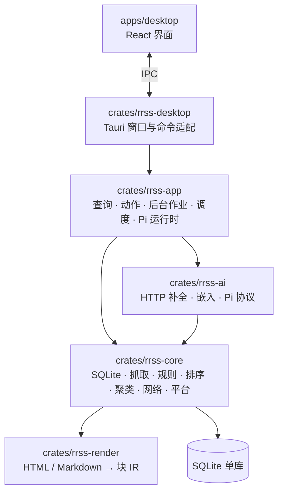

# 架构概览

RRSS 是 Windows / Linux 上的本地优先信息中枢：订阅、文章、全文索引、向量与对话都存在本机一个 SQLite 文件里；模型只调用你配置的端点。这份文档讲整体分层、数据怎么流动，以及安全和隐私边界。开发约定见 [CONTRIBUTING.md](../CONTRIBUTING.md)。

## 设计原则

- **规则先过滤，原因可解释**：主过滤是确定性的规则评分（作者、标签、关键词、正则、URL 等），每篇文章都能看到命中了哪些规则、加减了多少分。兴趣相似度只影响可见列表的排序，不改隐藏规则。
- **单库，不依赖额外服务**：结构化数据、全文索引（FTS5）和向量检索（sqlite-vec）都在同一个 SQLite 文件里，不需要安装数据库或向量服务。
- **不可信内容只走块 IR**：订阅正文和模型输出先清洗，再转成结构化的块（段落、标题、列表、表格、图片引用等），界面只渲染这些块。
- **两路 AI 各管各的**：摘要、简报、翻译、相近报道综述走 HTTP 补全；只有你主动发起对话或追问时才启动 Pi 子进程。

## 分层

- **界面**只画界面、管交互，所有调用经 `lib/api.ts`；IPC 的类型由 Rust 视图类型生成（`bindings.ts`），前后端字段不会各写一份。
- **宿主**只做适配：命令转接到 `rrss-app`，数据库访问放到阻塞工作线程，不占界面线程。
- **应用层**持有全部业务：给界面的查询、用户动作、后台作业（摘要、嵌入、媒体、聚类、排序、简报）和调度。
- **核心层**是纯后端领域逻辑；正文清洗调用 `rrss-render`。平台差异集中在 `rrss-core::platform` 一个模块。
- **AI 层**只管和模型端点、Pi 子进程通信，不持有业务状态。

## 数据流

1. **抓取**：调度器按订阅的间隔与限流抓取 RSS / Atom / JSON Feed，支持 ETag / 304；下载有期限和正文大小上限。
2. **入库**：正文清洗成块 IR，按规范化 URL 与 SimHash 去重；跨来源的同一事件聚成「相近报道」。
3. **评分与排序**：规则先给分并决定隐藏；可见文章再按兴趣、阅读行为等特征排序，结果存成可重建的缓存。
4. **展示**：今日焦点卡片流、阅读器、简报和搜索都只读这些结果；长列表虚拟化渲染。
5. **生成**：摘要、简报、翻译与综述按任务绑定的模型走 HTTP，自动生成有每日预算；不配模型时这些功能不可用，规则、阅读与搜索照常工作。
6. **对话**：引用以结构化快照（文章 ID 与块位置）传给 Pi，不把全文塞进输入框；Pi 只能通过应用提供的受限工具访问资料库，联网抓取网页需要你确认。

## 存储

- 一个 SQLite 文件，WAL 模式；表结构以 `crates/rrss-core/src/schema.sql` 为准，旧库由 `db/migrations.rs` 逐版升级。
- 全文检索用 FTS5 trigram，中文任意子串可搜；向量用 sqlite-vec，静态链接，不需要单独安装。
- 图片等媒体缓存在本地磁盘，按最近访问回收；设置里可以备份、恢复、清理和查看占用。

## 安全边界

- **主界面不跑外部代码**：不加载远程脚本与远程媒体，不用 iframe，不把字符串当 HTML 插进页面；Tauri 配置严格的 CSP。图片和直链音视频只经宿主的 `rrss://` 本地协议提供。
- **原网页隔离**：需要看原网页时，在主窗口里嵌入一个独立的子 webview 打开（只接受 http / https）。它有自己的进程与数据目录，不获得任何 IPC 权限。
- **Pi 权限**：Pi 运行在应用托管的独立目录里，不读你自己的 Pi 配置；外部工具（MCP）与联网抓取需要你开启或逐次确认。

## 网络与隐私

RRSS 自己发出的网络请求分三类，每一类都可以单独设代理：

| 用途 | 包括 |
| :-- | :-- |
| 内容网络 | 抓取订阅源；下载文章里的图片和站点图标到本地缓存；你打开的原网页 |
| 模型 API | 你在设置里配置的模型端点（摘要、简报、翻译、嵌入等） |
| Pi | 对话用的 Pi 运行时：启动时如果还没装，默认从 GitHub Releases 自动下载（可在设置里关闭）；自动更新默认关闭。对话时 Pi 访问你配置的模型端点 |

- **不发送使用统计**：没有遥测或崩溃上报；启动 Pi 时也会关闭它自带的安装统计。
- **代理**：可设全局代理，再按上面三类分别覆盖；支持 HTTP、HTTPS、SOCKS5、SOCKS5H。Windows 可读系统代理（WinINet 设置），Linux 读标准代理环境变量。应用里的每个网络入口都归到一类（`NetworkScope`），不直接创建未配置代理的客户端。原网页沿用「内容网络」的代理，遇到无法表达的代理组合时拒绝打开，不会绕过代理直连。Pi 子进程只接收代理环境变量，SOCKS5 是否生效取决于 Pi 与所用模型 SDK，设置页会提示。
- **凭据**：界面错误、运行日志和诊断包里的密钥、令牌与代理认证统一经 `rrss-core::logsafe` 清洗；文章正文、搜索词和模型响应不写进日志。

## 平台

- Windows：WebView2；发布包有 MinGW 交叉编译版和 MSVC 原生版。
- Linux：WebKitGTK 4.1。
- macOS 只在代码结构上预留，不发布。
